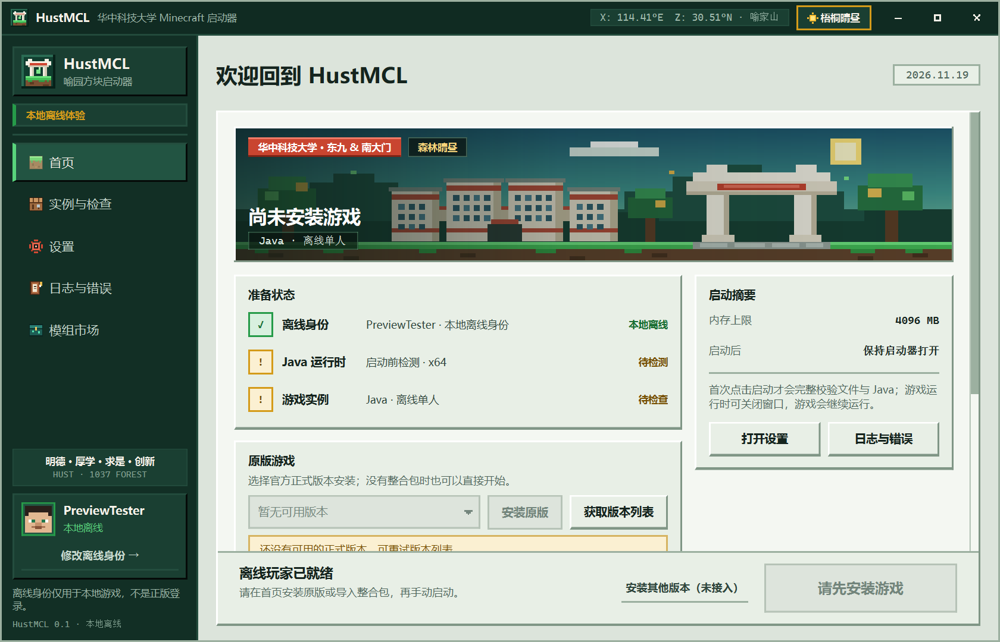

# HustMCL

面向华科同学的 Windows 10 / 11 x64 Minecraft Java 启动器。用 C++20 和 Qt Widgets 实现，支持原版安装、符合条件的整合包导入，以及微软账号和本地离线玩家两种启动方式。



## Preview 6 安装与使用

1. 解压分享包，运行 `HustMCL-Setup-Windows-x64.exe`，选择你希望保存启动器与游戏的目录。安装完成后打开 **HustMCL Accounts**。安装器未签名，可用包内的 `SHA256SUMS.txt` 核对下载完整性。
2. 在设置里选择登录方式。微软账号需要拥有 Minecraft Java 版，并在浏览器完成授权。本地离线玩家用于单机游戏。微软登录的续期凭据由 Windows 在当前用户下加密保存在本地，可在设置中退出登录。
3. 回到首页，选择官方原版版本，或拖入受支持的 ZIP / MRPACK 整合包。游戏和匹配的 Java 按需下载。安装完成后点 **启动游戏**。

安装包随附启动器和运行依赖。随后下载的内容、设置和存档统一放在安装目录的 `data/` 中。已有 HustMCL Accounts 可在原目录升级。卸载会保留 `data/`，再次安装时可选回原目录，更换目录时需自行备份和迁移游戏数据。

支持现代原版、Fabric，以及采用 Modrinth 清单的整合包，包括内嵌相应 MRPACK 的 PCL ZIP。Forge、NeoForge、Quilt 及其他清单格式暂未支持。模组市场可搜索并下载文件，实际安装由玩家处理。

## 为什么做这个项目

第一次装 Minecraft Java 时，选择版本、配置 Java、下载文件和启动经常混在一起。HustMCL 把安装与启动分成两步，在实例与检查页显示准备情况。像素界面以东九教学楼和南大门为首页横幅，提供浅色、深色和跟随本地时间的主题。设置页可以保存下次启动游戏时的 JVM 内存上限。

源码中，`src/core` 负责版本、Java 和安装计划的规则，`src/application` 编排安装和启动，`src/services` 处理下载、文件与系统调用，`src/ui` 展示状态，`src/app` 组装各层。可从 `tests/desktop/test_ui.cpp` 查看首页状态、整合包导入、主题切换和内存设置的回归验证。

## 从源码构建

准备 Qt 6.10.3（MinGW 64 位）、配套 MinGW 13.1 x64、CMake 3.24+、Ninja、Python 3.10+。以下示例使用 `C:/Qt`，请按实际 Qt 安装位置调整。

```powershell
$qt = 'C:/Qt/6.10.3/mingw_64'
$mingw = 'C:/Qt/Tools/mingw1310_64/bin'
$env:Path = "$mingw;$qt/bin;$env:Path"
cmake -S . -B build -G Ninja -DCMAKE_BUILD_TYPE=Release `
  -DHUSTMCL_BUILD_DESKTOP=ON -DHUSTMCL_PUBLIC_RELEASE=ON -DBUILD_TESTING=ON `
  "-DCMAKE_CXX_COMPILER=$mingw/g++.exe" "-DCMAKE_PREFIX_PATH=$qt"
cmake --build build --parallel 2
ctest --test-dir build --output-on-failure
.\build\src\app\hustmcl_desktop.exe
```

用 `--scenario home-ready` 可打开样例界面，适合评审 UI。这个入口使用样例数据，可以直接展示首页。

## 许可与反馈

HustMCL 原创代码和文档采用 [MIT 许可证](LICENSE)。Qt、MinGW 运行库、miniz 和上游测试数据遵循各自的许可或来源说明，详见 [第三方组件说明](third_party/README.md)、[测试数据来源](tests/fixtures/metadata/SOURCE.md)及安装包内的 `THIRD-PARTY-NOTICES`。分享包附 Qt 6.10.3 对应源码，Qt 动态库可用兼容构建替换。

HustMCL 是独立的学生项目。华中科技大学、Mojang 和 Microsoft 的名称及相关标识归各自权利人。

反馈时请附启动器版本、Windows 版本、复现步骤和错误码。提交前请移除个人路径、账号信息和令牌。 [GitHub Issues](https://github.com/qiu26258-beep/HustMCL/issues)
