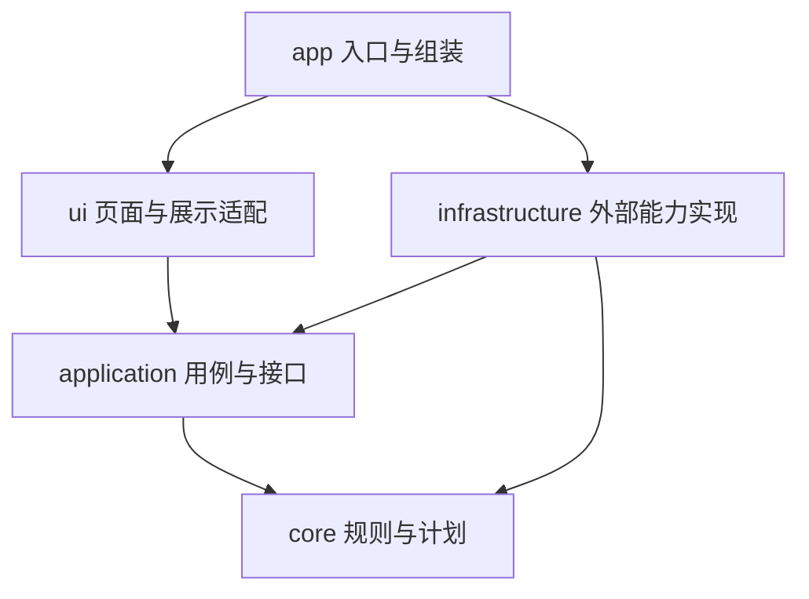

# HustMCL 架构设计

更新日期：2026-10-21。状态：MVP 实现约定；核心库与 Java 选择规则已有离线回归，其余约定按里程碑实施。实际构建范围见[构建与测试](构建与测试.md)，产品范围与性能目标以 [MVP 项目规划](MVP项目规划.md) 为准。

本设计把“可维护性优先”落实为依赖边界、单一状态来源和可重复验证。以下 HustMCL 方案是本项目的工程取舍，不是对参考项目完整架构的复刻或评价。

## 1. 参考项目与采用范围

本轮查看了两者官方 GitHub 仓库的 `main` 分支页面、构建文件和任务基础类型，访问日期为 2026-10-21。链接会随上游变化；本轮未固定上游提交，也没有构建、运行或完整审计这两个项目。后续如需采用具体实现，先记录提交 SHA、文件路径和适用许可。

| 参考依据 | 已核对事实 | HustMCL 的取舍 |
| --- | --- | --- |
| [PCL 官方仓库](https://github.com/Meloong-Git/PCL)与[工程文件](https://github.com/Meloong-Git/PCL/blob/main/Plain%20Craft%20Launcher%202/Plain%20Craft%20Launcher%202.vbproj) | 工程使用 VB.NET / WPF；可见页面、网络、下载与启动等文件分区；README 说明源码随发布同步 | 借鉴启动器能力分区、主操作入口与阶段反馈；采用本项目的 C++ / Qt 实现 |
| [PCL 任务类型 ModLoader](https://github.com/Meloong-Git/PCL/blob/main/Plain%20Craft%20Launcher%202/Modules/Base/ModLoader.vb) | 统一加载任务类型，存在状态、进度与 UI / 工作线程通知机制 | 用统一任务快照展示进度；将通知调度留在应用与 UI 边界，核心规则不访问控件 |
| [HMCL 构建模块](https://github.com/HMCL-dev/HMCL/blob/main/settings.gradle.kts)与[应用模块依赖](https://github.com/HMCL-dev/HMCL/blob/main/HMCL/build.gradle.kts) | 构建拆为 HMCL、HMCLCore、HMCLBoot 等模块，应用依赖核心模块 | 用 CMake 目标约束依赖，让核心规则能独立测试 |
| [HMCLCore 能力目录](https://github.com/HMCL-dev/HMCL/tree/main/HMCLCore/src/main/java/org/jackhuang/hmcl)与[Task 类型](https://github.com/HMCL-dev/HMCL/blob/main/HMCLCore/src/main/java/org/jackhuang/hmcl/task/Task.java) | 具有 auth、download、game、java、launch、task 等分区；Task 使用 JavaFX 类型 | 借鉴能力划分和任务组合思路；明确规定自己的 core 不依赖 UI，不把 Core 目录名当作隔离证明 |

不随参考项目扩展 MVP 范围：跨平台、多架构、模组市场、多加载器、复杂动画与自动更新仍延期。优先交付一个受验证原版的完整流程。

### 许可与来源记录

[PCL 的 LICENCE](https://github.com/Meloong-Git/PCL/blob/main/LICENCE)指向《PCL 分发有限许可》，并附有轻度 / 重度使用指南；指南自述不是法律文件或协议，不能将其概括为 MIT、Apache 或 GPL 一类许可。大量参考或移植实现前，需要核对其指向的正式许可及具体使用方式，本轮未完成该项复用评估。

HMCL 的 [LICENSE](https://github.com/HMCL-dev/HMCL/blob/main/LICENSE)为 GPLv3，[README](https://github.com/HMCL-dev/HMCL#license)另列修改版区分及版权声明相关条款。源码移植或改写不能仅靠更换语言判断是否满足许可。

当前仅记录阅读依据与本项目设计，没有导入两者的源码、图标或素材。若之后引入第三方内容，在同一提交记录来源、固定版本、所用文件、修改与许可处理，并同步项目的第三方声明。项目自身许可证仍待决定。

## 2. 最小模块与依赖方向

采用单体桌面程序，按职责分区。目标目录见主规划，以下名称对应未来的 CMake 目标，不要求现在创建空目录或占位类。



| 模块 | 负责 | 允许依赖 | 边界 |
| --- | --- | --- | --- |
| core | 版本规则、Java 需求、实例描述、安装与启动计划 | C++ 标准库、Qt Core 值类型 / JSON | 无控件、网络、Win32、真实文件 / 进程操作；环境信息由参数输入 |
| application | 登录、安装、启动用例；任务状态；外部能力接口 | core、Qt Core | 不包含具体服务或 QWidget；用替代服务可验证完整分支 |
| infrastructure | HTTP、文件存储、校验、解压、Java 探测、认证、凭据、进程实现 | application、core、所需 Qt 模块与系统库 | `services/`、`platform/` 先在一个目标内维护；平台头文件不泄漏到公共接口 |
| ui | 页面、展示状态、主按钮映射与线程间展示适配 | application、Qt Widgets | 不调用具体下载 / 凭据 / 进程实现，不重复判断版本兼容 |
| app | 创建服务、注入用例、连接页面与退出流程 | ui、infrastructure | 是实际实现的唯一组装入口，不承载业务规则 |

Qt Core 值类型可以降低转换成本，无需为了“纯 C++”再造字符串与 JSON 抽象；真正需要隔离的是副作用与 UI。核心函数接收解析好的环境、元数据和设置并返回结果，相同输入得到相同计划。

CMake 使用明确源文件列表、目标级依赖与 `PRIVATE` 实现依赖，不使用全局 include 路径让所有模块互相可见。M0 建立无 Widgets / Network 的核心测试目标，并对禁止依赖做自动检查；核心测试通过仍不能替代依赖检查。循环依赖通过调整职责解决，不建立无边界的 `common/` 或全局服务定位器。

外部接口只在首个用例需要替代真实行为时引入，例如元数据来源、文件获取、实例存储、Java 探测、会话获取和进程启动。一个接口对应一项明确能力；没有变化点的模型与规则使用普通值类型 / 函数。先做具体阶段编排，出现第二种真实需求后再抽取共用逻辑。

## 3. 计划、执行与展示的数据约定

| 模型 | 最小内容 | 约束 |
| --- | --- | --- |
| InstanceDescriptor | 稳定实例 ID、显示名、版本 ID、游戏目录、运行配置 | 显示名不作为目录唯一标识；保存 schemaVersion；存档独立于安装暂存区 |
| InstallPlan | 目标实例、文件需求（来源、相对目标、大小 / 摘要）、Java 需求、解压与校验阶段 | 无网络或文件操作；不包含账号 token；拒绝未知且必需的元数据规则 |
| LaunchPlan | Java 要求 / 选择结果、工作目录、classpath、分项参数模板、必要文件与会话引用 | 版本解析集中在 core；不拼接 shell 命令；凭据只在执行前短暂解析到内存 |
| TaskSnapshot | taskId、instanceId、阶段、已完成 / 总量、是否可取消、错误信息 | 以值传递只读快照；未知总量不显示虚构百分比；不持久化运行中快照作为恢复依据 |
| AppError | 稳定错误码、阶段、可重试标志、安全上下文 | 用户文案在 UI 映射；重试由错误类型决定，不解析异常文本；日志入口不暴露凭据 |

不要实现完整的通用计划语言。MVP 的安装计划只服务原版与 Java 环境；未来加载器可增加已明确的步骤，之后再判断是否需要更通用的表达。

认证、实例完整性和游戏进程是三种独立状态。首页主按钮从它们推导：需要登录时登录，实例缺失时安装，环境缺失时准备，全部满足时启动。计划成功或子进程创建成功都不等同于游戏进入主菜单；主菜单是实机验收结果。

## 4. 异步任务、取消与重试

应用层拥有任务状态的唯一写入入口。页面不能同时维护一份“安装中”布尔值；安装记录与运行状态也分别管理，避免游戏退出触发重新安装。

| 当前状态 | 允许的后续 | 规则 |
| --- | --- | --- |
| Idle | Planning | 检查冲突并取得写锁后创建新 taskId |
| Planning | Preparing、Failed、Cancelling | 验证元数据与目标路径；无效输入不开始下载 |
| Preparing | Downloading、Failed、Cancelling | 探测 / 准备所需 Java，检查磁盘与目录 |
| Downloading | Verifying、Failed、Cancelling | 有限并发、超时；复用已校验缓存；无需下载时直接校验 |
| Verifying | Committing、Failed、Cancelling | 校验最终依赖、解压结果与安装记录候选 |
| Committing | Succeeded、Failed | 短暂提交窗口不可取消；发布安装记录后才成功 |
| Cancelling | Cancelled、Failed | 停止派发与活动请求，等待工作线程退出 / 清理后释放锁 |
| Failed / Cancelled | Planning | 重试创建新 taskId，重新检查缓存与环境 |
| Succeeded | Idle | 只代表安装就绪，游戏启动另走独立用例 |

没有 Java 时，Preparing 内可执行有明确子阶段的运行时获取任务，复用下载与校验能力，不另写一套下载器。阶段内总进度未知时只展示子阶段与已传输量。

UI 与应用编排在主事件线程；QNetworkAccessManager 在其所属事件线程使用；有界工作线程池负责文件校验、解压与可能阻塞的探测。工作线程不访问 QWidget。服务归属 app，任务生命周期归 application；通过有接收对象的排队通知更新页面，销毁页面会断开通知，任务可以继续。

每次通知携带 taskId；取消、重试或切换实例后忽略过期结果。取消请求只进入 Cancelling，不能先显示 Cancelled 再继续写文件；所有出口都释放锁与临时资源。不得强行终止线程。

瞬态网络错误使用有次数上限的退避重试，遵守服务端限流提示；校验不符允许有限重新获取。磁盘不足、目录无权限、无游戏授权或无效元数据应直接给出操作建议，不无限重试。登出后旧认证回调不得重新保存凭据。

退出时，安装任务先完成协作取消再销毁其服务。游戏生命周期独立，后台日志写入方式与启动方式必须通过“关闭启动器后游戏继续运行”实测，不能只以进程 API 返回成功证明。

## 5. 数据、缓存与失败恢复

默认把可变数据放在用户数据目录；游戏目录可以另设。具体路径由存储服务集中决定，界面和 core 不自行拼出系统路径。

```text
<data-root>/
  config.json                 带 schemaVersion 的应用配置
  credentials/                平台加密的凭据；配置只引用账号 ID
  cache/                      校验后的可复用元数据与内容文件
  runtimes/                   按运行时标识隔离的 x64 Java
  instances/<stable-id>/
    instance.json             实例描述与已提交安装记录引用
    installations/            分代安装清单及必要的私有文件
    game/                     用户存档、设置与预留 mods
  staging/<task-id>/           本次下载 / 解压的未提交文件
  logs/                       按大小与数量轮转的脱敏日志
```

这只是逻辑布局。游戏目录在其他磁盘时，待发布文件必须在其最终位置的同卷暂存区生成，不假定跨卷移动是原子操作。Java 安装先在独立目录验证成功，再公布运行时引用。

MVP 对同一数据根的修改任务串行化，以跨进程写锁覆盖公共缓存 / 运行时更新及实例提交；游戏运行中的实例禁止修改。锁的失效恢复需检查持有进程，不能看到锁文件就随意删除。并发下载属于同一安装任务，不代表多个安装事务并发。

写入顺序为：获取并验证输入 → 临时下载 → 校验后发布缓存 → 新一代安装清单与私有文件 → 检查全部必要文件 → 原子更新实例的已提交记录引用。已有就绪清单和所引用内容在成功提交前保持可用；不就地覆盖会破坏旧清单的文件。启动用例取得一致的已提交清单后，再检查游戏运行冲突。

崩溃恢复以已提交记录与文件校验为准，不能相信上次的 Succeeded 文案。失败只遗留可识别暂存内容，不把半成品标记为就绪；首次安装尚无提交记录时显示未就绪。重试重新规划，复用可校验文件，不要求 MVP 实现分片断点续传或通用事务引擎。

配置损坏时保留原文件并报告修复入口，不静默覆盖；旧 schema 显式迁移并保留备份，遇到未来 schema 拒绝改写。QSettings 仅存窗口大小等 UI 偏好，账号、实例和 Java 设置不能在两套配置中重复保存。

解压校验绝对路径、`..`、Windows 盘符 / UNC / 设备路径、重解析点和符号链接逃逸；路径检查包含 Windows 大小写规则，并限制总解压大小和条目数量。只操作当前任务明确拥有的暂存路径；更新、取消和修复都不删除 `game/` 的用户内容。缓存自动回收暂缓，避免早期误删被已提交实例引用的文件。

令牌与带凭据的请求 / 参数禁止进入普通配置、计划文件、日志或错误快照；导出诊断时也执行统一脱敏。保留可关联的 taskId、错误码和版本信息，避免每层重复记录整份请求。

## 6. 测试与维护验收

测试以外部行为和失败恢复为依据，不为每个模型、getter 或转发接口增加镜像测试。默认回归无需公网、微软账号、已安装 Java 或游戏；真实认证、运行时来源与主菜单验证另记集成结果。

| 层次 | 代表场景 | 验证方式 |
| --- | --- | --- |
| core | Windows x64 规则、Java 需求、参数顺序、未知必需字段、中文与空格路径 | 固定元数据 / 环境输入，断言完整计划与错误；无需 QApplication |
| application | 已就绪直接启动、缺 Java、取消后迟到回调、重复操作、登出期间刷新完成 | 可控替代服务与事件时序，断言状态转移、调用边界与凭据处理 |
| infrastructure | 网络截断 / 限流、摘要不符、提交失败、崩溃恢复、恶意压缩包、配置迁移 | 本地 HTTP 测试服务、临时目录、构造输入与故障注入；不访问用户存档 |
| 构建边界 | core 引入 Widgets / Network、application 引入具体服务、目标循环依赖 | 最小链接目标与禁止依赖自动检查；不要仅扫描目录名 |
| 系统验收 | 无 Java 安装、真实授权、100% / 150% / 200% 缩放、关闭启动器后游戏存活 | Windows 10 / Windows 11 x64 干净环境；分别记录主菜单与性能结果 |

代码阶段统一提供 CMake configure / build 与 `ctest --test-dir <build-dir> --output-on-failure` 入口，具体 preset 随锁定工具链提交。Windows CI 执行同一套离线构建与回归；CI 通过不能代替 Windows 10 的最低构建号和干净机器验收。

每批改动完成的条件：已有相关基线记录；模块依赖方向成立；相关正常 / 失败测试通过；构建或依赖变更做配置与构建验证；检查 diff 与暂存区；记录验证并立即 git commit。执行顺序遵守根目录 [agent.md](../agent.md)。

## 7. M0 实施顺序与退出条件

M0.1 已建立核心库、presets、CTest 与核心依赖检查，Qt / MSVC 集成仍在推进；其余条目继续按退出条件验证。每一行可拆成小提交，但同一提交必须包含相应验证，不能先堆完整框架再补测试。

| 顺序 | 最小交付 | 退出条件 |
| --- | --- | --- |
| M0.1 构建与边界 | 确认 Qt / MSVC / SDK / CMake 精确版本与目标系统；最小 CMake 目标、presets、忽略规则、离线 CTest 及依赖检查入口 | x64 干净构建可重复；核心样例无需 Widgets / Network；用故意违反依赖的样例验证检查能失败；记录尚待干净系统确认的最低系统要求 |
| M0.2 首个规则用例 | 一份受验证原版元数据、环境模型、Java 需求和 LaunchPlan；小型替代服务驱动用例 | 覆盖规则、参数、无效输入与失败反馈；不访问真实账号；未确定的游戏版本明确保留为待决策 |
| M0.3 外部风险验证 | 独立验证应用注册 / Minecraft 授权链、Java 来源与校验、进程独立存活、Qt 部署；先做最小验证再建设完整适配器 | 每项有官方来源、实测步骤和结果；失败则修复或重新决策，不靠其他功能掩盖；不借用参考项目客户端凭据 |
| M0.4 页面与资源预算 | 最小 Widgets 页面接入同一用例与任务快照；部署包、Release 性能与干净系统记录 | UI 不阻塞；取消时序可重复；按主规划测资源；Windows 10 / Windows 11 x64 可运行；记录精确最低系统构建号 |

M0.2 只验证计划与编排，不等同于 M1 的真实游戏启动。M0.3 是优先排除外部阻碍的小实验，不提前实现整个 M2 下载器或 M3 登录界面。M0 全部退出条件通过后才进入 M1–M4 的功能验收。

新增加载器时优先增加元数据 / 计划规则和必要安装步骤；新增下载源只调整文件获取实现；新增校园主题只改 UI / resources；校园 SSO 另建身份用例，不侵入 Minecraft 授权。若这类单一改动需要同时修改所有层，先检查当前边界是否失效。
